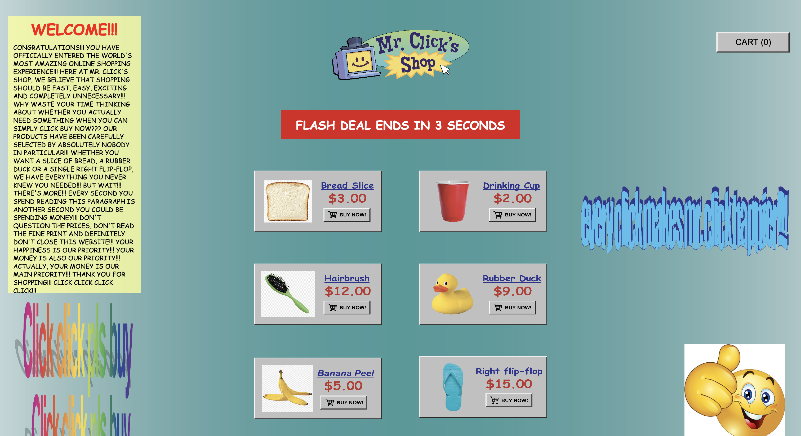
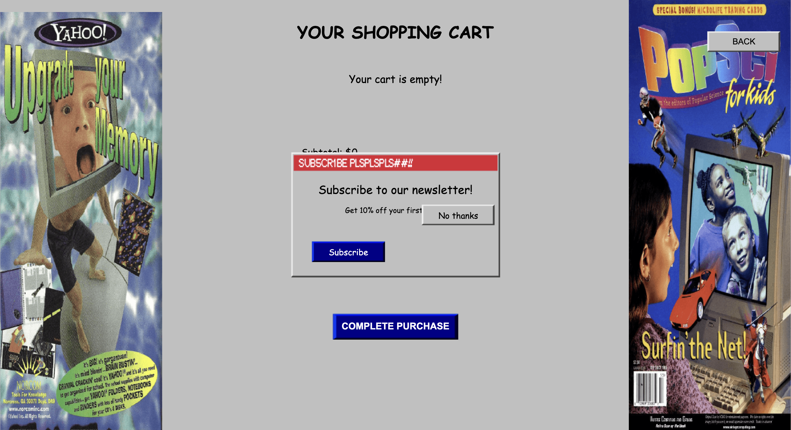

# Final Project — Mr Click's Shop


---

### The Project

Mr. Click’s Shop is an interactive satire of manipulative online shopping. Visitors enter a chaotic storefront where a “flash deal” countdown pressures them to grab absurd products, such as a single flip-flop, a slice of bread and a rubber duck, before they vanish. Every click spawns more noisy popups. At checkout, hidden fees appear one by one, a newsletter popup interrupts with a “No thanks” button that runs away from the cursor, and a VIP membership gets slipped into the total. Through exaggeration, the site makes dark patterns like false urgency, drip pricing, confirmshaming and forced subscriptions feel as irritating as they really are.

---

### Output




<!-- Drop a screenshot or GIF of your project.
     Got more to show? Add more images — let the work speak for itself.
     Save everything to a readme-assets/ folder inside this project folder. -->

[Watch Online](https://drive.google.com/drive/folders/19X-JdNguPdrdBopReQpiSAXDyDaeaSoS?usp=sharing)

<!-- Replace the link above with a URL to a screen recording or video of your final project.
     ⚠️ Make sure the file or page is set to public before submitting. -->

---

### ✍️ Reflection
At first we were just brainstorming (screenshot-03), considering everything from badly designed websites to pet games. Eventually we set out to create something ironic, fun and unserious, and I think we succeeded: our final work is an ironic website that comments on dark UX patterns in shopping sites such as Amazon, Shopee and Taobao. We noticed these patterns are especially overwhelming on Asian websites, likely because of a cultural context that calls for more reassurance in UX, and we broke down the features in screenshot-05. During ideation I was on the verge of a breakdown, because I felt a strong pull to design the shopping website but worried we couldn’t pull it off given our lack of confidence in coding. After a consult, Kapi helped us break the idea into concepts we had learnt in class, such as creating arrays, splicing, pushing and drawing rectangles, and we translated our features into p5.js code concepts in screenshot-04. Kapi also recommended making a user flow, which we did in screenshot-06, and we then built our first p5.js draft using rectangles and arrays (final-project-skeleton-image01). The biggest challenge was getting over that initial self-doubt. Once the idea was broken into digestible steps, it was much smoother sailing, since the design process was quite similar to Pong. With more time, I would make the pop-ups clickable to add depth, and add more types of listings for variety. Overall, I feel we executed our vision well and I’m quite satisfied with the project. I learnt so much about code, coming into this course with no coding background. -->

---

<!-- ─────────────────────────────────────────────────────
     GOING FURTHER — want to document more? Try any of these:

     ### ✨ Features
     A short list of what your project does.
     - Responds to mouse position and velocity
     - Generates sound based on particle density

     ### 🔍 Code Structure
     How are your files organised?
     - `sketch.js` — main setup and draw loop
     - `Agent.js` — autonomous agent class
     - `assets/` — images and sounds

     ### 🛠️ Hardware (if applicable)
     List any physical components used.
     - Arduino Uno
     - Sensor type and model

     ### 🧩 Something I'm Proud Of
     A snippet, a decision, a moment where it all came together.
     ```js
     // your code here
     ```

     ### 🔗 References
     Tutorials, libraries, artworks, or research that informed your project.
     ───────────────────────────────────────────────────── -->
